# AuraTunnel architecture

```mermaid
flowchart LR
    QR[Camera QR metadata] -->|user-triggered| UI
    CLIP[Clipboard / aura URL] -->|user-triggered| UI
    UI[SwiftUI Main App] -->|load/save/start/stop| M[NETunnelProviderManager]
    M --> SYS[iOS NetworkExtension preferences]
    UI <-->|low-frequency profile + snapshot| AG[(App Group)]
    UI -->|node credential URI| KC[(Shared Keychain)]
    EXT -->|credential reference| KC
    UI <-->|on-demand sendProviderMessage| EXT[PacketTunnel extension]
    SYS -->|launches| EXT
    EXT -->|one outstanding async read| TUN[NEPacketTunnelFlow]
    TUN --> B[system-provided packet batches]
    B --> FFI[bounded C FFI batch bridge]
    FFI --> LWIP[Leaf lwIP TCP/UDP netstack]
    LWIP --> PROXY[Leaf protocol and transport chain]
    PROXY --> SERVER[Proxy server]
    LWIP -->|64 packet target or 2 ms deadline| TUN
```

## Process and IPC boundaries

- The Main App owns UI, node import, configuration selection, and
  `NETunnelProviderManager`. It never handles raw IP packets.
- The Packet Tunnel extension owns TUN reads and an AuraTunnel-specific Leaf
  bridge. It uses Apple's public `NEPacketTunnelFlow` APIs instead of extracting
  a private socket file descriptor.
- App Group storage is for small, low-frequency Codable profiles and runtime
  snapshots. Imported credential URIs and private values are stored in a shared
  Keychain access group and referenced by an opaque ID.
- `NETunnelProviderSession.sendProviderMessage` is reserved for user-requested
  snapshots or infrequent control messages. It must not become a polling path.

## Product information architecture

AuraTunnel uses its own four-part navigation rather than reproducing another
proxy client's screens:

- **Connect** combines tunnel state, route preference, imported subscription
  groups, node selection, and user-triggered endpoint tests.
- **Library** owns QR/clipboard/external imports, subscription refresh, and a
  protocol inventory backed by the profiles actually stored on device.
- **Activity** renders only real endpoint-test and low-frequency extension IPC
  data. Empty states replace fabricated traffic history.
- **Settings** persists appearance, endpoint timeout, low-power test concurrency,
  route preference, and subscription expansion behavior. Diagnostics expose the
  real permission/configuration/core state without requesting new permissions.

The visual system uses AuraTunnel's midnight/ocean/aqua palette, branded hero,
and native dynamic-type materials; it does not copy the reference app's blue
navigation bars, row geometry, or configuration taxonomy.

## Anti-overheating choices already enforced

- One `readPackets` call is outstanding at a time; each callback's `Data` values
  are submitted as one FFI batch without concatenation, per-packet tasks, or
  polling. The required Rust ownership copy enters a bounded channel.
- Leaf runs on one dedicated single-thread Tokio runtime. Output is coalesced to
  64 packets or a two-millisecond sparse-traffic deadline before `writePackets`.
- Input and output queues are bounded; overload drops packets rather than
  allowing extension memory to grow without limit.
- Packet-scope logging is absent. App Group writes occur only on lifecycle
  transitions.
- The packet batch is handled in an `autoreleasepool`, then released immediately.
- The app and extension compile as separate processes with Swift 6 strict
  concurrency enabled and iOS 16 as the deployment target.
- QR scanning uses `AVCaptureMetadataOutput` with only `.qr` enabled, a bounded
  region of interest, a 640x480 capture preset, no sample-buffer output, and an
  immediate stop after the first result. The camera never runs in the background.

## Node import boundary

- Supported single-node payloads: `ss://`, `socks5://`, `vmess://`, `vless://`,
  `trojan://`, and `hysteria2://`/`hy2://`.
- `sub://BASE64(https://...)#name` is treated as a subscription rather than a
  server node. After confirmation, the Main App uses an ephemeral `URLSession`,
  accepts at most 4 MB / 500 supported nodes, de-duplicates stable node IDs, and
  performs Keychain writes off MainActor. Subscription networking never enters
  the Packet Tunnel process.
- Each subscription persists its stable node IDs. The home screen expands the
  group by default, and a refresh atomically replaces that subscription's node
  set so removed servers do not reappear as standalone nodes.
- A user can delete one node or an entire subscription. Deletion updates the
  selected profile and subscription membership atomically, then removes only
  Keychain entries no longer referenced by another node or subscription.
- Import and node selection update only App Group/Keychain state. The system
  `NETunnelProviderManager` profile is installed or updated only after an
  explicit Connect action, so VPN permission/signing failures cannot roll back
  an otherwise valid imported node list.
- After every import, the app verifies that all parsed stable node IDs exist in
  both the published model and App Group storage. A successful import creates a
  visible receipt and returns to the Connect tab; a mismatch reports parsed,
  in-memory, and persisted counts instead of silently showing an empty list.
- Clipboard access uses SwiftUI's system `PasteButton` and occurs only after the
  user taps it. Surrounding chat text is accepted when it contains one supported
  node or subscription URI.
- Each node exposes test, subscription refresh, share, URL inspection, edit,
  hide/unhide, QR generation, address copy, and deletion actions. Raw credential
  URIs are loaded from the shared Keychain only for the explicit action. The
  same action set is available from both the trailing menu and a long press on
  the complete node row.
- Subscription downloads use `URLSession.waitsForConnectivity`, a bounded
  resource deadline, and at most one delayed compatibility retry. A transient
  first-launch path cannot fail immediately, and there is no reachability poll.
- Node candidates are de-duplicated by their deterministic ID before persistence
  and merged through an ID-keyed dictionary, so importing an identical node
  overwrites its existing record rather than increasing the list count.
- External callers use
  `auratunnel://import?url=<percent-encoded-node-url>`; all three entry points
  share the same size limit, parser, confirmation UI, and secure persistence.

## Endpoint connectivity test

- The home screen offers per-node and test-all actions. Tests run only after
  explicit user intent in the Main App; they never enter the Packet Tunnel.
- Each TCP result measures a single `NWConnection` handshake with a five-second
  deadline. At most three connections run concurrently, which bounds radio and
  scheduler work for large subscriptions.
- A successful TCP handshake proves only that the host and port are reachable.
  It does not claim that VMess/VLESS authentication or proxy forwarding works.
  UDP-only nodes are labeled as such because a connectionless UDP socket becoming
  ready would not prove that the remote server responded.

## Forwarding capability and safety gate

The vendored Leaf core is pinned to commit
`1d20301570395cff1db5f3e316222b0ec3b4732e` and built with an iOS-only feature
set. VMess, VLESS, Trojan, Shadowsocks, and SOCKS5 are enabled. Hysteria 2,
Reality, QUIC, Leaf's API server, and automatic configuration watching are not
included in this build.

The extension reads the selected node URI from shared Keychain, converts it to
in-memory Leaf JSON, validates that JSON through Leaf, applies TUN settings, and
only starts packet reads after the Leaf runtime reports running. Unsupported
protocols/transports and malformed credentials fail before traffic capture;
unexpected core termination cancels the system tunnel instead of leaving a
false connected state. Startup uses one 15-second deadline rather than polling,
and extension failures survive the following `stopTunnel` callback so the app
can display the actual cause.

`NEPacketTunnelNetworkSettings.tunnelRemoteAddress` is the numeric virtual peer
`10.0.0.1`; the proxy server hostname remains exclusively in Leaf's outbound
configuration. This prevents iOS from rejecting DNS hostnames as invalid tunnel
network settings.

The user does not manually create a VPN in Settings. AuraTunnel calls
`NETunnelProviderManager.saveToPreferences()` after explicit intent, which lets
iOS present the system authorization sheet and store the Packet Tunnel profile.
The Home screen exposes this as “Prepare system VPN” for diagnostics; Connect
also performs the same check before starting a completed forwarding engine.

## Important measurable limits

`NEPacketTunnelFlow.readPackets` does not expose a minimum batch-size parameter.
iOS decides how many packets each callback returns, so code cannot truthfully
“force every read to contain at least 64 packets.” Waiting to accumulate 64
would increase memory, jitter, and interactive latency. The implementation
therefore consumes the entire system batch and coalesces upstream writes up to
64 packets,
with a short deadline for sparse traffic.

Likewise, no implementation can guarantee zero heat or a fixed `<15 MB` memory
ceiling for all devices, protocols, packet sizes, and throughput. The release
gate must be physical-device Energy Log, CPU, thermal-state, and extension
resident-memory measurements under defined workloads.
